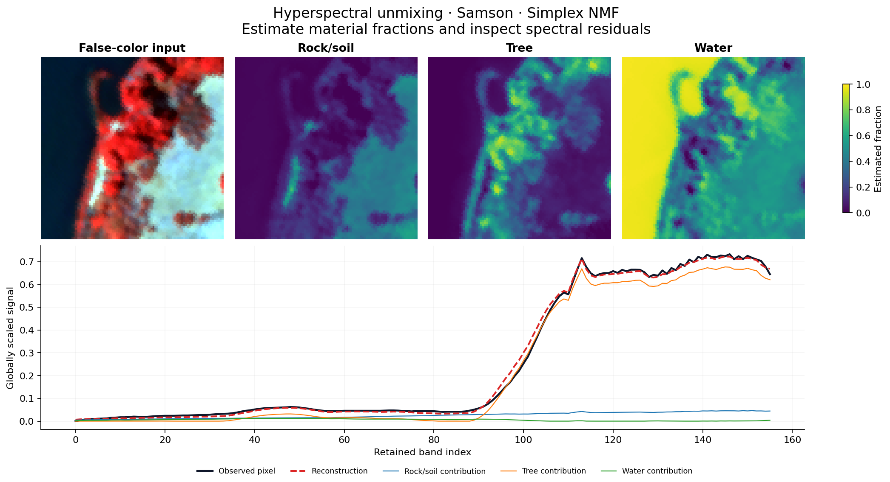

# Hyperspectral Unmixing

[](https://github.com/amersaidi2002-byte/hyperspectral-unmixing/actions/workflows/tests.yml)

[](LICENSE)

**Estimate material spectra and fractions from hyperspectral images.** Compare
pure-pixel extraction, constrained matrix factorization and spatial regularization,
then inspect where reconstruction quality disagrees with material recovery.



## What is implemented

- **SPA + FCLS:** pure-pixel selection followed by fully constrained least squares.
- **Simplex NMF:** joint estimation of nonnegative spectra and fractions summing to one.
- **Spatial NMF:** the same factorization with a four-neighbor abundance penalty.
- **112 measured fits:** Samson (95 × 95 × 156), Jasper Ridge (100 × 100 × 198),
  and controlled synthetic mixtures with/without pure pixels at three noise levels.
- A local pixel inspector, an executed notebook, saved numerical outputs, and a
  report showing spectral angles, fraction errors, residuals and failure cases.

Everything runs on a CPU. This is per-scene unsupervised decomposition with a
supplied component count, rather than a classifier or pretrained transfer model.

## Measured results

| Scene | Method | SAD ↓ (°) | Fraction RMSE ↓ | Relative residual ↓ |
|---|---|---:|---:|---:|
| Jasper | Simplex NMF | 12.99 | 0.183 | 0.043 |
| Jasper | SPA + FCLS | 19.86 | 0.181 | 0.208 |
| Jasper | Spatial NMF | 14.39 | 0.197 | 0.043 |
| Samson | Simplex NMF | 6.89 | 0.354 | 0.031 |
| Samson | SPA + FCLS | 5.25 | 0.258 | 0.234 |
| Samson | Spatial NMF | 7.14 | 0.361 | 0.031 |

NMF rows average five initialization seeds; deterministic SPA runs once per real
scene. Lower is better. The [full report](docs/experiment.md) includes standard
deviations, timings, all synthetic cases and optimization diagnostics.

**A smaller residual does not guarantee better fractions.** On both real scenes,
Simplex NMF reconstructs the image more closely, while SPA + FCLS has the lowest
fraction RMSE among these baselines. Equal-weight smoothing does not consistently
help. Real references are benchmark estimates, so disagreement is not a direct
measurement of field accuracy. No state-of-the-art ranking is claimed.

## Explore the results

```bash
git clone https://github.com/amersaidi2002-byte/hyperspectral-unmixing.git
cd hyperspectral-unmixing
python -m venv .venv
source .venv/bin/activate
python -m pip install -e . -c constraints.txt
hsi-unmix explore
```

Open **http://127.0.0.1:7861**. On Windows PowerShell, activate the environment with
`.\.venv\Scripts\Activate.ps1`. The synthetic scene works immediately from committed
fits. Choose a method and material, click any map, and compare the observed spectrum,
weighted component contributions and reference fractions. Arrow keys move one pixel.

To add the real scenes, stop the explorer, run the command below, then restart it:

```bash
hsi-unmix download
hsi-unmix explore
```

The download is approximately 7 MB; all four files are pinned to a source revision
and verified by SHA-256. Raw source data is not committed. The inspector reads
saved fits and does not retrain when you change a selector.

<details>
<summary>Pixel inspector screenshot</summary>


</details>

## Reproduce the comparison

```bash
hsi-unmix download
hsi-unmix benchmark --output runs/reproduction
hsi-unmix report --results runs/reproduction --output runs/reproduction-report
```

Settings live in [configs/benchmark.json](configs/benchmark.json). The committed
[experiment manifest](results/experiment.json) records the configuration digest,
source checksums, package versions and all 112 run paths. Each run records metrics,
constraint errors, timing and optimization diagnostics; seed 0 also includes full
precision spectra and fractions in a checksummed NPZ file. No reference labels are
passed to fitting, no best restart is selected, and a nonempty benchmark output
folder is rejected to avoid mixing experiments.

NMF uses a fixed 300-step budget. In this run, all 80 NMF fits reached that budget;
none met the strict objective-change stopping rule. These are budget-limited
comparisons, not claims of convergence to a global optimum. Runtime depends on the
machine; the report states the actual hardware and timing scope.

## Fit your own cube

Supply a NumPy array shaped **rows × columns × bands**, with finite nonnegative
values and nonzero spectral rank sufficient for K components:

```bash
hsi-unmix fit --input cube.npy --components 3 --method simplex-nmf --output runs/custom.npz
```

Values are used as supplied. Scale raw sensor counts with one global factor before
fitting so the regularization setting has a comparable meaning. The output contains
`endmembers` (K × bands), `abundances` (rows × columns × K), and a JSON diagnostic
sidecar. Components are unlabeled; physical names require independent interpretation.

## Check the implementation

```bash
python -m pip install -e ".[dev]" -c constraints.txt
ruff check src tests scripts
ruff format --check src tests scripts
pytest
python scripts/execute_notebook.py
python scripts/check_explorer.py
python scripts/verify_results.py
```

The 25 tests include FCLS comparisons against an independent SLSQP optimizer,
exact-mixture recovery, simplex constraints, finite-difference spatial gradients,
MATLAB pixel order, checksum rejection and an offline HTTP workflow. GitHub Actions
runs lint, formatting, tests and notebook execution without downloading research data.
The last two commands additionally check the committed artifacts; real scenes
require `hsi-unmix download`. Use `--data runs/missing` with `check_explorer.py` to
exercise the synthetic-only fallback.

## Read the project

| Entry | Purpose |
|---|---|
| [Executed notebook](notebooks/01_synthetic_unmixing.ipynb) | Follow one synthetic example from mixtures to spectra |
| [Experiment report](docs/experiment.md) | Review the measurements, figures and failure cases |
| [Methodology](docs/methodology.md) | Objectives, solvers, alignment and evaluation protocol |
| [Walkthrough](docs/walkthrough.md) | Navigate the implementation and explain the design choices |
| [Source package](src/spectral_unmixing) | Algorithms, data loaders, CLI, reporting and local explorer |
| [References](docs/references.md) | Primary papers, benchmark provenance and data terms |

## Scope and limitations

Pure-pixel extraction is sensitive to noise and missing pure materials. Blind NMF
is nonconvex and may be non-identifiable; enforcing the simplex does not make a
mixture physically unique. Equal-weight spatial regularization can blur boundaries.
The real references are estimates, and Samson reference spectral amplitudes are
independently normalized: spectral angles compare shape, not calibrated amplitude.
Band indices are shown because the distributed files do not supply wavelength
calibration. These small benchmarks do not demonstrate cross-sensor transfer or
operational material mapping.

Code is distributed under [GPL-3.0](LICENSE). Downloaded benchmarks retain their
original provider terms; see [NOTICE](NOTICE) and [data references](docs/references.md).
