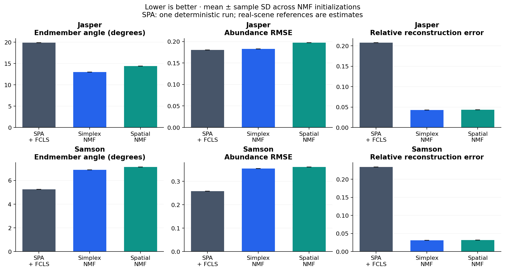
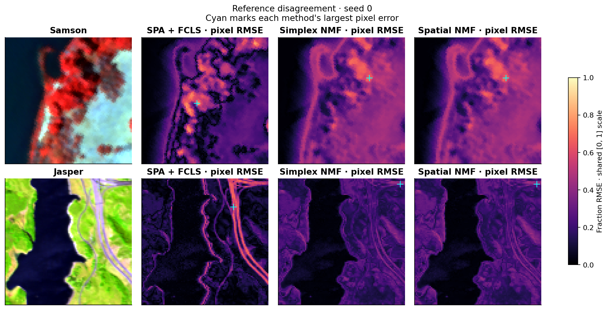
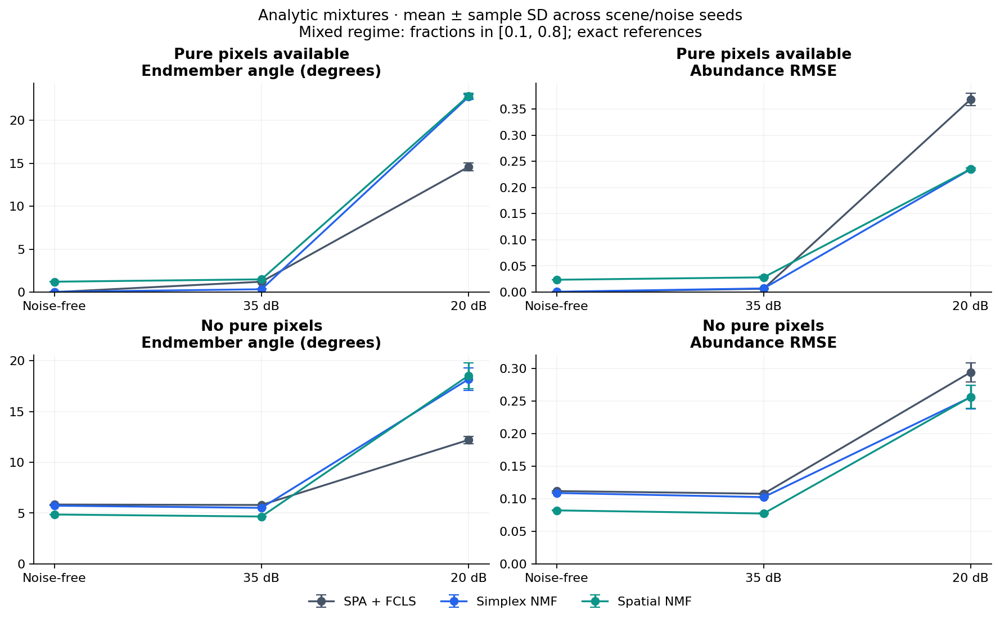

# Experiment report

Generated from **112 completed fits**. Configuration SHA-256:
`e7b013bd58fd1099124a4b18babb9aa29914d647cb6fda628a7bfc852e734fe8`. Figures always use seed 0; every configured run is retained.

## Real-scene comparison

| Scene / case | Method | Runs | SAD ↓ (°) | Abundance RMSE ↓ | Reconstruction ↓ | Fit time (s) |
|---|---|---:|---:|---:|---:|---:|
| Jasper | Simplex NMF | 5 | 12.99 ± 0.00024 | 0.183 ± 2.4e-06 | 0.043 ± 9.4e-07 | 8.55 ± 0.22 |
| Jasper | SPA + FCLS | 1 | 19.86 | 0.181 | 0.208 | 0.64 |
| Jasper | Spatial NMF | 5 | 14.39 ± 0.00016 | 0.197 ± 5.1e-06 | 0.043 ± 1.1e-06 | 8.71 ± 0.41 |
| Samson | Simplex NMF | 5 | 6.89 ± 5.1e-05 | 0.354 ± 4.8e-05 | 0.031 ± 2.8e-07 | 5.92 ± 0.13 |
| Samson | SPA + FCLS | 1 | 5.25 | 0.258 | 0.234 | 0.23 |
| Samson | Spatial NMF | 5 | 7.14 ± 0.00077 | 0.361 ± 4.1e-05 | 0.031 ± 2.9e-07 | 6.50 ± 0.22 |

NMF values are mean ± sample standard deviation over initialization seeds. SPA runs
once per real scene. Standard deviations are not confidence intervals and do not
measure transfer to other scenes. Full precision is retained in results/summary.csv.

## What the measurements show

- **Samson:** lowest reconstruction error: Simplex NMF (0.031); lowest abundance RMSE: SPA + FCLS (0.258).
- **Jasper:** lowest reconstruction error: Simplex NMF (0.043); lowest abundance RMSE: SPA + FCLS (0.181).

Reconstruction and material recovery answer different questions. Low residuals do
not establish correct endmembers or fractions. Simplex constraints remove arbitrary
NMF scaling freedom, but blind unmixing can remain non-identifiable. Illumination
changes, uncertain references and nonconvex local minima also matter.

## Controlled synthetic experiment

Analytic spectra are mixed with exact fractions; they are not laboratory signatures.
Pure scenes contain pure patches; mixed scenes constrain every fraction to [0.1, 0.8].
Gaussian noise is scaled to the requested SNR before zero clipping. Realized SNR and
clipping counts are saved. Synthetic seeds vary texture, noise and initialization.

- **mixed-clean, Simplex NMF:** SAD 5.727 degrees, abundance RMSE 0.1087, reconstruction error 0.000041.
- **pure-snr20, Simplex NMF:** SAD 22.733 degrees, abundance RMSE 0.2349, reconstruction error 0.098408.
- **pure-snr35, Simplex NMF:** SAD 0.329 degrees, abundance RMSE 0.0070, reconstruction error 0.017584.

The high-SNR pure case checks recovery under favorable assumptions. At 20 dB, noisy
extreme-pixel selection deteriorates. In the noise-free mixed case, near-perfect
reconstruction coexists with fraction errors, illustrating non-identifiability.

| Scene / case | Method | Runs | SAD ↓ (°) | Abundance RMSE ↓ | Reconstruction ↓ | Fit time (s) |
|---|---|---:|---:|---:|---:|---:|
| mixed-clean | Simplex NMF | 5 | 5.73 ± 0.0061 | 0.109 ± 0.00035 | 0.000 ± 1.7e-06 | 1.39 ± 0.071 |
| mixed-clean | SPA + FCLS | 5 | 5.84 ± 0.0031 | 0.112 ± 0.00013 | 0.001 ± 6.3e-06 | 0.05 ± 0.0048 |
| mixed-clean | Spatial NMF | 5 | 4.86 ± 0.016 | 0.082 ± 0.00035 | 0.000 ± 3.3e-06 | 1.57 ± 0.058 |
| mixed-snr20 | Simplex NMF | 5 | 18.19 ± 1.1 | 0.256 ± 0.018 | 0.098 ± 2.6e-05 | 1.34 ± 0.093 |
| mixed-snr20 | SPA + FCLS | 5 | 12.21 ± 0.36 | 0.294 ± 0.015 | 0.180 ± 0.0012 | 0.05 ± 0.0052 |
| mixed-snr20 | Spatial NMF | 5 | 18.54 ± 1.3 | 0.256 ± 0.017 | 0.098 ± 2.5e-05 | 1.57 ± 0.098 |
| mixed-snr35 | Simplex NMF | 5 | 5.51 ± 0.018 | 0.102 ± 0.00072 | 0.018 ± 3.1e-06 | 1.58 ± 0.16 |
| mixed-snr35 | SPA + FCLS | 5 | 5.80 ± 0.025 | 0.108 ± 0.00083 | 0.023 ± 0.00038 | 0.06 ± 0.021 |
| mixed-snr35 | Spatial NMF | 5 | 4.66 ± 0.018 | 0.077 ± 0.00064 | 0.018 ± 3.1e-06 | 1.88 ± 0.15 |
| pure-clean | Simplex NMF | 5 | 0.03 ± 0.015 | 0.001 ± 0.00029 | 0.000 ± 1.3e-06 | 1.46 ± 0.15 |
| pure-clean | SPA + FCLS | 5 | 0.00 ± 0 | 0.000 ± 3e-11 | 0.000 ± 1.4e-11 | 0.04 ± 0.0063 |
| pure-clean | Spatial NMF | 5 | 1.21 ± 0.03 | 0.024 ± 0.00045 | 0.000 ± 3.5e-06 | 1.63 ± 0.11 |
| pure-snr20 | Simplex NMF | 5 | 22.73 ± 0.32 | 0.235 ± 0.0023 | 0.098 ± 2.8e-05 | 1.47 ± 0.15 |
| pure-snr20 | SPA + FCLS | 5 | 14.58 ± 0.45 | 0.368 ± 0.012 | 0.222 ± 0.0018 | 0.06 ± 0.017 |
| pure-snr20 | Spatial NMF | 5 | 22.85 ± 0.29 | 0.235 ± 0.0022 | 0.098 ± 2.7e-05 | 1.77 ± 0.21 |
| pure-snr35 | Simplex NMF | 5 | 0.33 ± 0.031 | 0.007 ± 0.00098 | 0.018 ± 3e-06 | 1.30 ± 0.078 |
| pure-snr35 | SPA + FCLS | 5 | 1.21 ± 0.033 | 0.006 ± 0.0012 | 0.023 ± 0.00019 | 0.04 ± 0.0019 |
| pure-snr35 | Spatial NMF | 5 | 1.48 ± 0.049 | 0.028 ± 0.0014 | 0.018 ± 3e-06 | 1.54 ± 0.086 |

## Optimization and timing

0/80 iterative fits met the objective-change stopping rule.
Others reached the fixed 300-step budget. Neither condition
proves a global optimum. Each run records objective traces and FCLS diagnostics.

Times include SPA, initialization and abundance fitting with 1
BLAS thread(s). They exclude downloads, source loading, reference matching, metrics
and figures. Hardware: AMD EPYC 9V74 80-Core Processor; Python 3.12.14.
These small per-scene timings are not production throughput measurements.

## Reference and preprocessing caveats

- Samson has 95 × 95 pixels, 156 bands and three references. Source labels are
  1-rock, 2-Tree, 3-water; Rock/soil is used as the first display label.
- Jasper Ridge has 100 × 100 pixels, 198 retained bands and four references:
  1-tree, 2-water, 3-dirt, 4-road. Its retained bands are selected in the source file.
- MATLAB column-major pixel order is preserved. Jasper raw counts are divided by
  maxValue=5000, then each scene uses one global maximum scale. Fitting does not
  independently standardize bands. False color independently stretches display channels only.
- Real reference maps are benchmark estimates, not exact field measurements.
  Samson reference component amplitudes are separately normalized. Spectral angles
  compare shape; reference spectra are never a calibrated reconstruction oracle.
- Spectrum figures peak-normalize for display only. Wavelength calibration is not
  supplied, so real-scene plots use retained band indices.
- K is supplied and every scene pixel is available for unsupervised fitting. This is
  per-scene decomposition, not held-out classification or sensor-transfer testing.
- Hungarian spectral matching happens after fitting, for permutation alignment only.
  No reference-driven hyperparameter search or best-seed display is performed.
- Equal-weight spatial smoothing may erase small structures or cross boundaries.

See [methodology](https://github.com/amersaidi2002-byte/hyperspectral-unmixing/blob/main/docs/methodology.md)
and [source references](https://github.com/amersaidi2002-byte/hyperspectral-unmixing/blob/main/docs/references.md).
